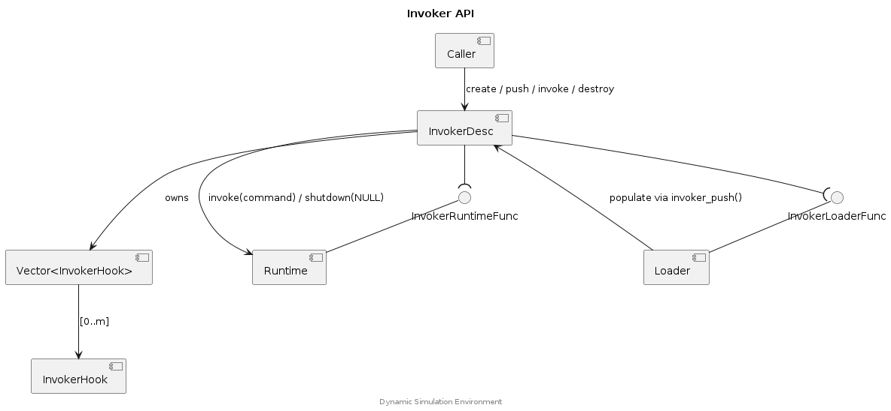

## Invoker API


The Invoker API provides a command invocation mechanism using caller provided
runtime and (command) hooks.


### Component Diagram

<div hidden>

```text
@startuml invoker-api

skinparam nodesep 55
skinparam ranksep 40

title Invoker API

component "Caller" as caller
component "InvokerDesc" as inv
component "Vector<InvokerHook>" as hooks
component "InvokerHook" as hook
component "Loader" as loader
component "Runtime" as runtime
interface "InvokerLoaderFunc" as loaderFunc
interface "InvokerRuntimeFunc" as runtimeFunc

caller --> inv : create / push / invoke / destroy
inv ---> hooks : owns
hooks ---> hook : [0..m]

inv --( loaderFunc
loaderFunc -- loader
loader --> inv : populate via invoker_push()

inv --( runtimeFunc
runtimeFunc -- runtime
inv --> runtime : invoke(command) / shutdown(NULL)

center footer Dynamic Simulation Environment

@enduml
```

</div>




### Example


The following example demonstrates how to use the Invoker API.

```c
--8<-- "apis/clib/examples/invoker.c"
```


## Typedefs

### InvokerDesc

```c
typedef struct InvokerDesc {
    InvokerRuntimeFunc runtime_func;
    void* runtime_ctx;
    int hooks;
}
```

### InvokerHook

```c
typedef struct InvokerHook {
    InvokerHookId id;
    const char* name;
    const char* command;
}
```

### pthread_attr_t

```c
typedef struct pthread_attr_t {
    char[56] __size;
    long __align;
}
```

## Functions

### invoker_create

Create an invoker with a runtime function and optionally load its hooks.

#### Parameters

runtime_func (InvokerRuntimeFunc)
: Runtime function used to execute hooks. Must not be NULL.

loader_func (InvokerLoaderFunc)
: Optional function used to populate the invoker's hooks. Pass NULL to skip
    loading.

#### Returns

InvokerDesc
: Initialized invoker. If `runtime_func` is NULL, `errno` is set to `EINVAL`.
    If `loader_func` returns a nonzero value, the invoker is destroyed and
    `errno` is set to `ECANCELED`.


### invoker_destroy

Destroy an invoker and release its registered hooks. If a runtime function is
configured, it is called with a NULL hook before the hooks are released.

#### Parameters

inv (InvokerDesc*)
: Pointer to the InvokerDesc, or NULL.

#### Returns

void
: The invoker was destroyed, or the pointer was NULL.


### invoker_invoke

Invoke the command for a hook ID using the configured runtime function. If no
matching hook exists, or its command is NULL or empty, no runtime call is made.

#### Parameters

inv (InvokerDesc*)
: Pointer to the InvokerDesc.

id (InvokerHookId)
: ID of the hook to invoke.

#### Returns

N (int)
: Return value from the runtime function, or zero if no command was invoked.

-EINVAL (-22)
: `inv` is NULL or has no runtime function.


### invoker_push

Copy hooks into an invoker and sort them by hook ID. The input array must end
with an entry whose `name` and `command` are both NULL. Hook strings are copied
and owned by the invoker.

#### Parameters

inv (InvokerDesc*)
: Pointer to the InvokerDesc.

hooks (const InvokerHook*)
: Sentinel-terminated array of hooks to copy into the invoker.

#### Returns

0 (int)
: Hooks were copied successfully.

-EINVAL (-22)
: `inv` or `hooks` is NULL.


